# PetBot
A small AI-powered desk pet robot that moves, talks and keeps you company when you're bored.

## Bill of Materials

### Movement

| Image | Item | Qty | Unit price | Total | Link | Why I picked it |
|:--:|:--|--:|--:|--:|:--|:--|
| 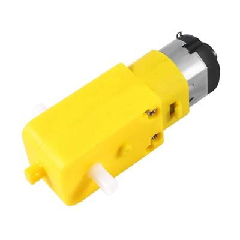 | TT Geared Motor | 2 | 25 EGP / $0.50 | 50 EGP / $1.00 | [Flux Electronix](https://fluxelectronix.com/shop/tt-geared-motor-for-smart-car-robot-3-6vdc/) | I chose a DC gear motor over a stepper because it's cheaper and more suitable because we don't need precise positioning. The yellow TT motor was the cheapest viable option, and I used two instead of four to reduce costs, since the robot's lightweight design doesn't need any more torque. |
|  | 65mm Smart Car Robot Tire Wheel | 2 | 25 EGP / $0.50 | 50 EGP / $1.00 | [Flux Electronix](https://fluxelectronix.com/shop/65mm-smart-car-robot-tire-wheel/) | It's simpler and cheaper than 3d printing a custom wheel and it fits perfectly on the motor I chose |
| 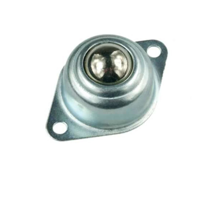 | Metal Caster Wheel 30mm | 1 | 35 EGP / $0.70 | 35 EGP / $0.70 | [Future Electronics](https://store.fut-electronics.com/products/metal-caster-wheel-for-robot-1?_pos=2&_sid=bf10dcad0&_ss=r) | Although we could balance the robot on two wheels, adding a caster wheel expands the support polygon, helping keep the CoM inside it thus preventing tipping. |
| 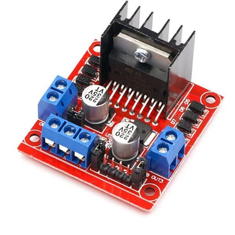 | L298N Motor Driver Module | 1 | 75 EGP / $1.50 | 75 EGP / $1.50 | [Flux Electronix](https://fluxelectronix.com/shop/l298n-motor-driver-module/) | It's just a driver for the tt dc motors |
| 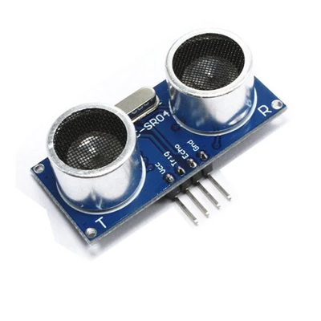 | HC-SR04 Ultrasonic Sensor Module | 2 | 40 EGP / $0.80 | 80 EGP / $1.60 | [Flux Electronix](https://fluxelectronix.com/shop/hc-sr04-ultrasonic-sensor-module/) | wall detection (for anti crash system) |
| 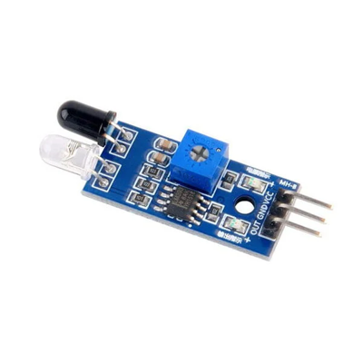 | IR Infrared Obstacle Avoidance Tracking Sensor Module | 2 | 30 EGP / $0.60 | 60 EGP / $1.20 | [Flux Electronix](https://fluxelectronix.com/shop/ir-infrared-obstacle-avoidance-tracking-sensor-module/) | Edge detection to prevent falling |

**Subtotal: 350 EGP / $7.00**

### Peripherals & AI System

| Image | Item | Qty | Unit price | Total | Link | Why I picked it |
|:--:|:--|--:|--:|--:|:--|:--|
| 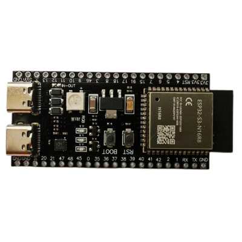 | ESP32-S3-DevKitC-1 N16R8 | 1 | 520 EGP / $10.40 | 520 EGP / $10.40 | [Future Electronics](https://store.fut-electronics.com/products/esp32-s3-devkitc-1-copy?_pos=4&_sid=670c7245a&_ss=r) | At first I wanted to use the pi pico 2w for this project but this esp is cheaper, has better wifi, has more pins, has better resources (which means easier vibecoding), has more psram and uses usbc |
| 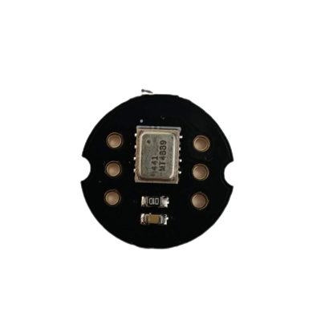 | INMP441 MEMS Microphone - I2S | 1 | 220 EGP / $4.40 | 220 EGP / $4.40 | [Future Electronics](https://store.fut-electronics.com/products/inmp441-mems-microphone-i2s?_pos=5&_sid=cbaa97927&_ss=r) | It's the cheapest viable option for a microphone. I contemplated replacing it with a cheaper condenser microphone but claude said it's much better for speech recognition and that the price difference is worth it |
| 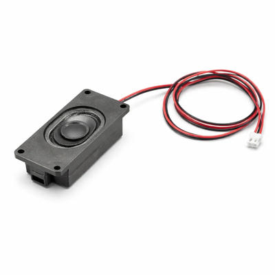 | Speaker - 3W 4 Ohm | 1 | 80 EGP / $1.60 | 80 EGP / $1.60 | [Future Electronics](https://store.fut-electronics.com/products/speaker-3w-4-ohm?_pos=1&_sid=cbaa97927&_ss=r) | It's the cheapest speaker with an enclosure that isn't too quiet. well worth the price |
| — | PAM8403 Stereo Audio Amplifier Module 2x3W | 1 | 35 EGP / $0.70 | 35 EGP / $0.70 | [Flux Electronix](https://fluxelectronix.com/shop/pam8403-stereo-audio-amplifier-module-2x3w/) | I added this because the ESP32-S3 can't natively drive a speaker because it doesn't have a dac pin. Therefore an amplifier module needs to be used with a PWM pin and an RC filter. I picked this version over the plain PAM8403 for the same price because it has a volume knob with an on/off switch and a 470uF filter capacitor already on the board. |

**Subtotal: 855 EGP / $17.10**

### Structure and Supports

Quantities, prices and links are still to be decided.

- 3d printing outer shell
- m3 copper spacers
- m3 screws
- black acrylic
- clear acrylic
- Foam for mic insulation

### Power Regulation

| Image | Item | Qty | Unit price | Total | Link | Why I picked it |
|:--:|:--|--:|--:|--:|:--|:--|
| 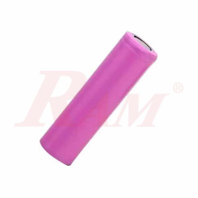 | Battery 3.7V 18650 Lithium Rechargeable (Capacity is 2000 MAH) | 2 | 95 EGP / $1.90 | 190 EGP / $3.80 | [RAM Electronics](https://www.ram-e-shop.com/shop/battery-18650-row-battery-3-7v-18650-lithium-rechargeable-8310) | I think these would be the most suitable batteries for powering the robot. I'm still gonna ask Assem to tell me if this battery is any good since most batteries on the market are trash. Update ( Assem told me to check the size against the battery cell holder) |
| 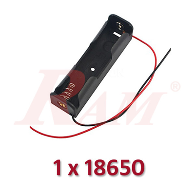 | 18650 single-cell battery holder with wires | 2 | 8 EGP / $0.16 | 16 EGP / $0.32 | [RAM Electronics](https://www.ram-e-shop.com/shop/battery-holder-18650x1-battery-holder-1x18650-7380) | Two single holders let me wire the cells in series and attach the BMS balance wire (BM) at the junction between them. |
| 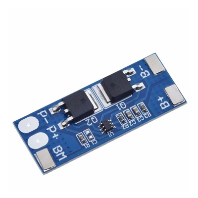 | BMS 2S 8A, 7.4v Li-Ion Battery Protection Board | 1 | 40 EGP / $0.80 | 40 EGP / $0.80 | [Flux Electronix](https://fluxelectronix.com/shop/bms-2s-8a-8-4v-li-ion-battery-protection-board/) | it protects the batteries when charging and discharging (super important) and it balances the charge of the 2 batteries |
| 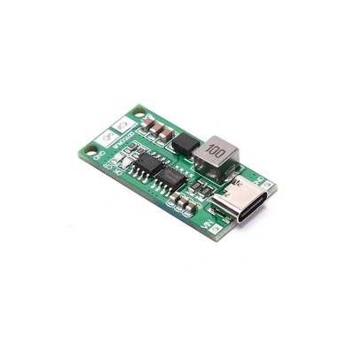 | 2S 2A 18650 Lithium Battery Charger module Type-C | 1 | 55 EGP / $1.10 | 55 EGP / $1.10 | [Flux Electronix](https://fluxelectronix.com/shop/2s-2a-18650-lithium-battery-charger-module-type-c/) | Charges the 2S pack from a normal 5V USB-C charger, so it's cheaper than a DC-plug charger. It charges up to 8.4V. We need to measure the output with a multimeter, though, before connecting the cells and try charging the cells only before connecting the rest of the components because it could screw everything up . (output should be about 8.4V and NOT A BIT HIGHER) |
| 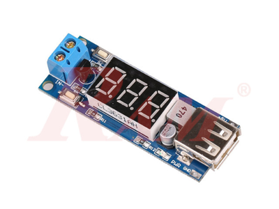 | DC-DC Step Down Voltage Converter 2A USB With Voltmeter (4.5V~40Vdc to Fixed Output 5V/2A) | 1 | 0 EGP / $0.00 | 0 EGP / $0.00 | [RAM Electronics](https://www.ram-e-shop.com/shop/dc-dc-302-dc-dc-step-down-voltage-converter-2a-usb-with-voltmeter-4-5v-40vdc-to-fixed-output-5v-2a-sku-dc302-7282) | Steps the 7.4V battery down to 5V for the ESP32-S3 (through a Schottky diode into its 5V pin), the PAM8403 amplifier, the L298N logic and the sensors. It's also good because it's free since I already own it. |
| 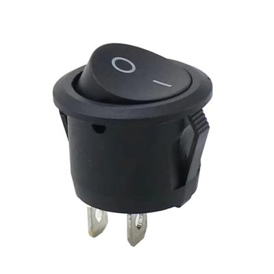 | Round Rocker Switch ON-OFF Black (6A,250VAC) | 1 | 7 EGP / $0.14 | 7 EGP / $0.14 | [Flux Electronix](https://fluxelectronix.com/shop/round-rocker-switch-on-off-black-6a250vac/) | an on/off switch for the robot |

**Subtotal: 308 EGP / $6.16**

### Miscellaneous

Resistors, capacitors, diodes, headers, breadboard, and the wires and cables that connect the parts above.

| Item | Qty | Unit price | Total | Link | Why I picked it |
|:--|--:|--:|--:|:--|:--|
| Resistors 1/4W (1k x4, 2k x3, 10k x5, 47k x2, 100k x2) | 16 | 1 EGP / $0.02 | 16 EGP / $0.32 | — | 1k + 2k make a voltage divider on each HC-SR04 Echo pin (5V to 3.3V, because the ESP32-S3 pins are not 5V tolerant). 1k + 10k are for the speaker filter. 100k (top) + 47k (bottom) divide the battery voltage for the ADC, so 8.4V becomes about 2.7V. Two 10k pull the L298N ENA and ENB pins to ground so the motors stay off while the ESP boots, and one 10k pulls the talk button up. One spare of each value. Estimated price. |
| Ceramic capacitor 100nF 50V (PF104) | 8 | 0.5 EGP / $0.01 | 4 EGP / $0.08 | [Flux Electronix](https://fluxelectronix.com/shop/ceramic-capacitor-0-1uf-50v-100nf-50v-code-pf104/) | 100nF across each motor (2), on the battery divider (1), across the talk button (1) and on the ESP32-S3 5V and 3V3 pins (2), plus 2 spare. |
| Ceramic capacitor 10nF 50V (PF103) | 1 | 0.5 EGP / $0.01 | 0.5 EGP / $0.01 | [Flux Electronix](https://fluxelectronix.com/shop/ceramic-capacitor-10nf-50v-pf103/) | The store has no 15nF, so this goes in parallel with the 4.7nF to make 14.7nF for the first speaker filter stage (C11, after the 1k). Cutoff stays at about 10.8 kHz. |
| Ceramic capacitor 4.7nF 50V (PF472) | 1 | 0.5 EGP / $0.01 | 0.5 EGP / $0.01 | [Flux Electronix](https://fluxelectronix.com/shop/ceramic-capacitor-4-7nf-50v-pf472/) | In parallel with the 10nF to make the 14.7nF for C11. |
| Ceramic capacitor 1nF 50V (PF102) | 1 | 0.5 EGP / $0.01 | 0.5 EGP / $0.01 | [Flux Electronix](https://fluxelectronix.com/shop/ceramic-capacitor-0-001uf-50v-1nf-50v-code-pf102/) | The store has no 1.5nF, so this goes in parallel with the 470pF to make 1.47nF for the second speaker filter stage (C12, after the 10k). Cutoff stays at about 10.8 kHz. |
| Ceramic capacitor 470pF 50V (PF471) | 1 | 0.5 EGP / $0.01 | 0.5 EGP / $0.01 | — | In parallel with the 1nF to make the 1.47nF for C12. |
| Ceramic capacitor 470nF 100V (PF474) | 1 | 0.6 EGP / $0.01 | 0.6 EGP / $0.01 | [Flux Electronix](https://fluxelectronix.com/shop/ceramic-capacitor-470nf-100v-pf474/) | Replaces the 1uF DC-blocking capacitor (C13) going into the PAM8403 input, since the store has no 1uF ceramic. It only cuts bass below about 15-20 Hz, which the 3W speaker can't play anyway. |
| Ceramic capacitor 22nF 50V (PF223) | 1 | 0.5 EGP / $0.01 | 0.5 EGP / $0.01 | [Flux Electronix](https://fluxelectronix.com/shop/ceramic-capacitor-22nf-50v-223/) | Spare for tuning the sound. Together with the 2.2nF it replaces the two filter pairs if the speaker has a high-pitched hiss, lowering the cutoff to about 7 kHz, which is still clear for speech. |
| Ceramic capacitor 2.2nF 50V (PF222) | 1 | 0.5 EGP / $0.01 | 0.5 EGP / $0.01 | [Flux Electronix](https://fluxelectronix.com/shop/ceramic-capacitor-2-2nf-50v-pf222/) | Spare, used with the 22nF as described above. |
| Electrolytic capacitor 470uF 16V | 3 | 3 EGP / $0.06 | 9 EGP / $0.18 | — | One across the L298N motor supply terminals and one across the 5V rail at the converter output (before the diode), so motor spikes and load steps from the amplifier don't reset the ESP32-S3. One spare. Estimated price. |
| Electrolytic capacitor 100uF 16V | 2 | 2 EGP / $0.04 | 4 EGP / $0.08 | — | One on the ESP32-S3 5V pin and one on its 3V3 pin. The dev board's 3.3V regulator is small and WiFi transmit bursts can brown it out without extra capacitance. Estimated price. |
| 1N5819 Schottky diode | 2 | 3 EGP / $0.06 | 6 EGP / $0.12 | — | Goes in series between the 5V converter and the ESP32-S3 5V pin (anode to the converter, stripe to the board), so I can plug in USB-C for programming while the battery is on without USB power flowing back into the converter. Only the ESP32-S3 is fed through it. The amplifier and sensors connect to the 5V rail before the diode. One spare. Estimated price. |
| Female pin header 1x40 (breakable) | 2 | 5 EGP / $0.10 | 10 EGP / $0.20 | — | Cut into two 1x22 sockets for the ESP32-S3 DevKitC-1 so I can swap the board later without desoldering. The leftover pins make sockets for the mic and sensor connections. Estimated price. |
| Male pin header strip 40-pin (breakable) | 2 | 3 EGP / $0.06 | 6 EGP / $0.12 | — | Needed if the ESP32-S3 board arrives without pins soldered on (the listing doesn't say). Also for the INMP441 mic and the sensor boards if they come unsoldered. Estimated price. |
| Momentary push button (talk button) | 2 | 2 EGP / $0.04 | 4 EGP / $0.08 | — | Press-to-talk for the robot, with one spare. Wired between a GPIO and ground, with a 10k pull-up and a 100nF capacitor to debounce it. The robot mutes the mic while it speaks, so a button is the simplest way to start listening. Estimated price. |
| Dupont jumper wires 40 pcs (male-female, male-male, female-female) | 3 | 35 EGP / $0.70 | 105 EGP / $2.10 | — | Connects the ESP32-S3, mic, sensors and L298N on the breadboard. Estimated price. |
| Breadboard 830 points | 1 | 90 EGP / $1.80 | 90 EGP / $1.80 | — | For testing the circuit before I solder anything. The ESP32-S3 DevKitC-1 is wide and leaves very few free holes next to its pins, so the sensors and the L298N connect with jumper wires. Estimated price. |
| Perfboard 7x9 cm | 2 | 25 EGP / $0.50 | 50 EGP / $1.00 | — | For the final soldered version of the power wiring, the dividers, the speaker filter and the ESP32-S3 sockets. Estimated price. |
| 140Pcs Breadboard Solid Jumper Wires Set with Plastic Box | 1 | 60 EGP / $1.20 | 60 EGP / $1.20 | [Flux Electronix](https://fluxelectronix.com/shop/140pcs-breadboard-solid-jumper-wires-set-with-plastic-box/) | Pre-cut solid wires that lie flat on the breadboard, so the short links (5V rail, GND, the HC-SR04 dividers, the speaker filter) stay tidy and don't pop out like Dupont wires do. The Dupont wires are still for the modules. Estimated price. |
| 2-pin screw terminal block, 5.08mm pitch (PCB mount) | 6 | 5 EGP / $0.10 | 30 EGP / $0.60 | — | Soldered on the perfboard so wires can be screwed in and taken out without desoldering: VSW and GND in from the switch, 5V and GND in from the USB-A breakout, power out to the L298N and to the PAM8403, the talk button, and one spare. Estimated price. |
| Cable ties (small, pack of 100) | 1 | 20 EGP / $0.40 | 20 EGP / $0.40 | — | Keep the motor, battery and sensor wires tied to the chassis so they don't snag on the wheels. Estimated price. |
| USB-A plug to screw terminal breakout | 1 | 25 EGP / $0.50 | 25 EGP / $0.50 | — | The DC-DC converter I own gives 5V through a USB-A port, so I need a way to take the 5V and GND out as wires. Estimated price. |
| Heat shrink tubing assortment | 1 | 30 EGP / $0.60 | 30 EGP / $0.60 | — | Insulates every soldered joint on the battery pack, BMS, fuse holder and switch. Bare joints on a 2S Li-ion pack can short against each other. Estimated price. |
| 3A slow-blow fuse + holder | 1 | 12 EGP / $0.24 | 12 EGP / $0.24 | — | Goes in the battery positive wire right after the BMS and before the switch, so it covers the motors and the converter. Slow-blow so motor start-up current doesn't blow it. Protects the wiring if a motor stalls or something shorts. Estimated price. |

**Subtotal: 484.6 EGP / $9.69**

### Cost Summary

| Section | Cost |
|:--|--:|
| Movement | 350 EGP / $7.00 |
| Peripherals & AI System | 855 EGP / $17.10 |
| Power Regulation | 308 EGP / $6.16 |
| Miscellaneous | 484.6 EGP / $9.69 |
| **Total** | **1997.6 EGP / $39.95** |

**In HC hours:** 15 Hours

## Pin Map

| Signal | ESP32-S3 GPIO | DevKitC-1 header pin | Connects to | Notes |
|:--|:--|:--|:--|:--|
| I2S clock (mic) | GPIO4 | J1-4 | INMP441 SCK | The ESP32-S3 is the I2S master. |
| I2S word select (mic) | GPIO5 | J1-5 | INMP441 WS | — |
| I2S data in (mic) | GPIO6 | J1-6 | INMP441 SD | INMP441 L/R pin goes to GND. INMP441 VDD goes to 3V3 only, never 5V. |
| Speaker audio out (PWM) | GPIO7 | J1-7 | 1k, then 15nF to GND, then 10k, then 1.5nF to GND, then 1uF in series into the PAM8403 left input | Use a PWM carrier well above 20 kHz (for example 10-bit at about 78 kHz). Turn the PAM8403 volume knob right down before the first power-on. |
| HC-SR04 #1 TRIG | GPIO14 | J1-20 | HC-SR04 #1 TRIG | — |
| HC-SR04 #1 ECHO | GPIO15 | J1-8 | Midpoint of the 1k / 2k divider on the sensor ECHO pin | Never connect ECHO straight to the ESP, it is 5V. |
| HC-SR04 #2 TRIG | GPIO16 | J1-9 | HC-SR04 #2 TRIG | — |
| HC-SR04 #2 ECHO | GPIO17 | J1-10 | Midpoint of the 1k / 2k divider on the sensor ECHO pin | Never connect ECHO straight to the ESP, it is 5V. |
| IR edge sensor 1 OUT | GPIO18 | J1-11 | IR sensor 1 OUT | Power the IR sensors from 3V3 so the output is 3.3V. |
| IR edge sensor 2 OUT | GPIO21 | J3-18 | IR sensor 2 OUT | Power the IR sensors from 3V3 so the output is 3.3V. |
| L298N IN1 | GPIO8 | J1-12 | L298N IN1 | Left motor direction. |
| L298N IN2 | GPIO9 | J1-15 | L298N IN2 | Left motor direction. |
| L298N IN3 | GPIO10 | J1-16 | L298N IN3 | Right motor direction. |
| L298N IN4 | GPIO11 | J1-17 | L298N IN4 | Right motor direction. |
| L298N ENA (PWM) | GPIO12 | J1-18 | L298N ENA, plus a 10k pull-down to GND | Remove the ENA jumper on the module. Keep PWM at about 90% or less, because the TT motors are rated 3-6V. |
| L298N ENB (PWM) | GPIO13 | J1-19 | L298N ENB, plus a 10k pull-down to GND | Remove the ENB jumper on the module. Keep PWM at about 90% or less. |
| Battery voltage (ADC1) | GPIO1 | J3-4 | Midpoint of the 100k (to VSW) / 47k (to GND) divider, with 100nF to GND | 8.4V full becomes about 2.7V. |
| Talk button | GPIO39 | J3-9 | Push button to GND, 10k pull-up to 3V3, 100nF to GND | — |
| Free (no screen) | GPIO2, 38, 40, 41, 42, 47 | J3-5, J3-10, J3-8, J3-7, J3-6, J3-17 | Not connected | Safe to use later. On some DevKitC-1 versions the onboard RGB LED is on GPIO38. |
| Do not use | GPIO35, 36, 37 | J3-11 to J3-13 | Not connected | Used by the octal PSRAM on the N16R8 module. |
| Do not use | GPIO0, 3, 45, 46 | J3-14, J1-13, J3-15, J1-14 | Not connected | Boot strapping pins. |
| Do not use | GPIO19, 20 | J3-20, J3-19 | Not connected | Native USB. |
| Do not use | GPIO43, 44 | J3-2, J3-3 | Not connected | UART0 for the serial monitor. |

### Power Wiring

| Power connection | Header pin | Connects to | Notes |
|:--|:--|:--|:--|
| Battery pack | — | 2 x 18650 in series into the BMS (B+, BM at the junction, B-) | Charger module and load both connect to BMS P+ and P-. B- connects to the cells only; nothing else goes to it. |
| Fuse and switch | — | BMS P+ to 3A slow-blow fuse to rocker switch to VSW | VSW feeds the L298N 12V pin, the DC-DC input and the battery divider. |
| 5V rail | — | DC-DC 5V output (through the USB-A breakout) | Feeds the PAM8403, both HC-SR04 and the L298N 5V pin. |
| ESP32-S3 5V pin | J1-21 | 5V rail through the 1N5819 (anode to the rail, stripe to the ESP) | Lets USB-C stay plugged in without feeding power back into the converter. |
| 3V3 | J1-1, J1-2 | INMP441 VDD and both IR sensors | Supplied by the dev board's regulator. |
| GND | J1-22, J3-1, J3-21, J3-22 | BMS P-, common ground for everything | Converter, ESP, L298N, sensors, amplifier, mic and charger OUT- all share it. The cells' negative goes only to BMS B-, never to this ground, or the BMS can't protect the pack. |